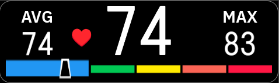
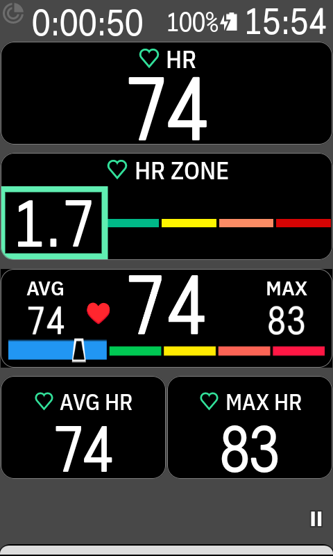

# Karoo HR Zones

**Heart rate and heart rate zone monitoring for Hammerhead Karoo 3.**

Karoo HR is an extension for Hammerhead Karoo that displays your heart rate directly on your cycling computer. Monitor your current, average and maximum heart rate, together with dynamic heart rate zones, while riding.

## Screenshots

### Karoo HR Zones  – Heart Rate Field

### Karoo 3 – Full Screen

## Features

- **Current heart rate** – see your live heart rate.
- **Average heart rate** – track your average heart rate during a ride.
- **Maximum heart rate** – monitor your peak heart rate.
- **Dynamic heart rate zones** – see which heart rate zone you are currently in.
- **Designed for Hammerhead Karoo** – integrated into the Karoo Extensions ecosystem.

## Installation

1. Open the Extensions section on your Hammerhead Karoo.
2. Find Karoo HR in the extension catalog.
3. Select Install.
4. Add the Karoo HR data field to your ride screen.

## Get Karoo HR Zones

Find and install Karoo HR through the Extensions section on your Hammerhead Karoo device.

For the latest version and release information, visit the [Releases page](https://github.com/mirml/karoo-hr-zones/releases).

## Developer

Developed by [mirml](https://github.com/mirml).
